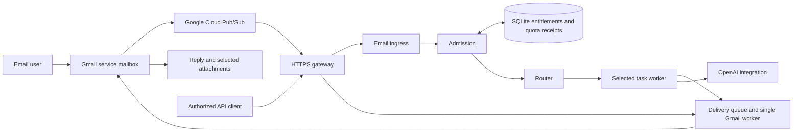
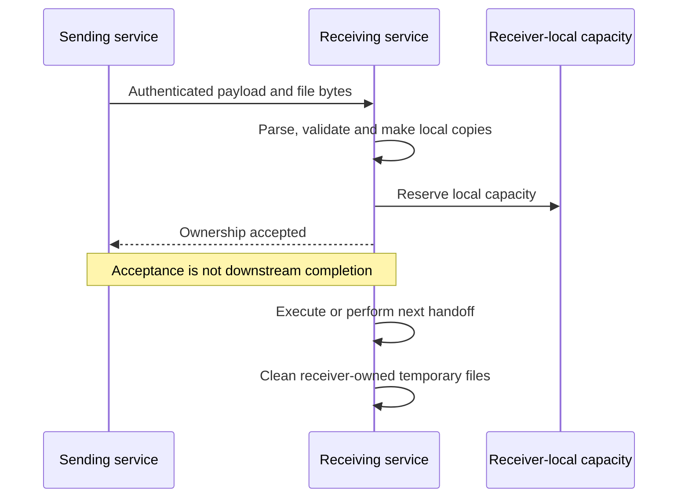

# Architecture

## System boundary

QDF operates on a service-owned Gmail mailbox. Users submit ordinary email; the implementation does not provide customer Gmail OAuth onboarding or store a separate OAuth grant for each customer. An application authorization layer determines which task a request may invoke.

The direct Delivery API is a separate authenticated entry point. It bypasses admission and task execution; it is not a second route for running AI tasks.

## Components and responsibilities

| Component | Responsibility | State and execution model |
| --- | --- | --- |
| Email ingress | Resolve Gmail history, filter eligible messages, normalize request fields and download attachments | Persistent history checkpoint; transient request files |
| Admission | Validate entitlement, validity period, task availability and quota; hand off authorized work | SQLite entitlement/receipt store; bounded in-memory handoff queue |
| Router | Resolve the authorized task identifier and forward copied request data | Explicit route registry; bounded local handoff workers |
| Base AI task | Call the Responses API, extract response text and explicitly select a generated text artifact | Local execution queue and per-key exclusion |
| Notification-analysis task | Assemble sources, run a typed agent workflow, validate exact facts and render the response | Independent task-local source/model/configuration boundary |
| Retrieval-oriented task | Implements a separate document-curation path | Retained implementation; operational acceptance excluded |
| Delivery | Validate output files, accept bounded responsibility, build MIME and submit through Gmail | Bounded queue, one Gmail submission worker, transient local copies |
| HTTPS gateway | Terminate TLS and route public requests to the appropriate backend | Nginx configuration; application-owned API-key validation |

Each task implementation owns its models, dependencies and Docker build context. The reference task is scaffolding to adapt, not a shared runtime superclass or an imported dependency of the other tasks.

## Data flow and ownership

1. A mailbox notification causes ingress to resolve Gmail history and retrieve relevant messages.
2. Ingress normalizes the request and copies any input files for the admission handoff.
3. Admission checks authorization and records quota ownership transactionally before enqueuing new work.
4. Router resolves the authorized task and hands off the serialized payload and paired file bytes.
5. The selected task executes locally, then supplies an explicit list of output artifacts to Delivery.
6. Delivery creates its own file copies and queue reservation before accepting responsibility. Its worker submits the email independently of the task's completed handoff.

## Decisions and tradeoffs

**HTTP contracts with local queues.** This keeps service boundaries explicit without introducing a distributed broker. It also means accepted work can be lost during process failure: queues are volatile, and the entitlement database does not store executable jobs.

**Receiver-owned file copies.** Each service can clean its own files after its responsibility ends. The cost is additional network and disk I/O; the benefit is avoiding cross-container filesystem coupling and accidental reliance on another service's temporary path.

**Explicit artifact selection.** A task lists generated files intentionally. Directory scanning and implicit input-file echoing are avoided. The base task's response file is a task-specific behavior, not a requirement that every task return a file.

**Persistent quota receipts, limited guarantees.** Receipts protect repeated quota charging and duplicate acceptance behavior for recorded request identifiers. They do not establish exactly-once model execution, transactional end-to-end delivery, or provider idempotency.

**One outbound Gmail worker.** Submission concurrency is deliberately constrained. This simplifies provider interaction and local ownership but makes email submission a throughput bottleneck.

**Small-host Compose deployment.** A single-host deployment has a manageable operational footprint, but the repository does not establish high availability, horizontal scaling or rolling deployments without interruption.

**Model interpretation plus deterministic checks.** Source IDs and exact-value checks improve traceability where text is locally available. They cannot prove that a model's interpretation is complete or legally correct.
