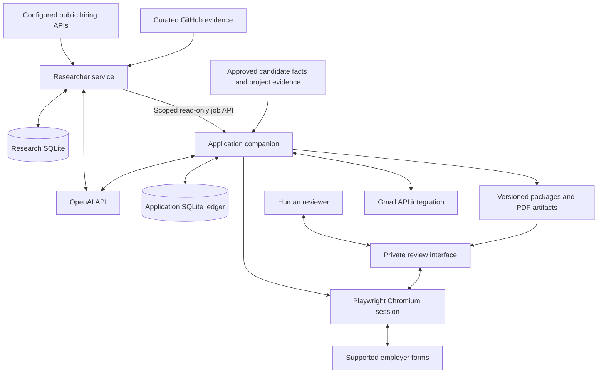

# JobResearcher — Architecture

> Source: the supplied private-project case-study export, reviewed on 14 November 2026. Test and deployment statements below describe that export and its dated records; they were not rerun in this public documentation repository.

## System boundary

The system is a single-host, two-service deployment. Each service owns its SQLite store and scheduler. Discovery does not submit applications. Application preparation reads the research service through a dedicated read credential; it does not mount the research database or its WAL sidecars.

Gmail supports mailbox processing and guarded delivery code. The diagram represents implemented integration boundaries, not an assertion that all write paths are enabled. Current recorded operation requires human final submission.

## Components and responsibilities

| Component | Responsibility |
|---|---|
| ATS adapters | Retrieve bounded public API data and normalize provider-specific fields, locations, identifiers, and publication dates. |
| Research scheduler | Check configured sources, rank relevant opportunities, reuse current assessments, and report coverage and safety stops. |
| Selection policy | Enforce publication freshness and configured education exclusions before paid evaluation; recheck age when results are read. |
| Research evaluator | Request schema-constrained relevance assessments with evidence references and validate returned fields. |
| Research store | Preserve jobs, content hashes, last observations, source health, assessments, evidence, and run summaries. |
| Portfolio evidence cache | Retain curated, attributed project claims; check source anchors at pinned commits and flag changed evidence for review. |
| Application engine | Synchronize opportunities, evaluate readiness, prepare artifacts, and process work within limits. |
| Application ledger | Own opportunity uniqueness, processing states, events, receipts, mailbox cursors, and persistent dismissals. |
| Browser and review interface | Fill supported forms, handle approved upload workflows, stream the session, and accept human input. |
| Document pipeline | Select approved facts, preserve required project coverage, render PDFs, and validate artifacts. |

## Data flow

### Discovery and assessment

1. Retrieve each configured source within response-size, request, scan, and time bounds.
2. Normalize jobs and calculate stable identities and content hashes.
3. Persist observations and rank technical matches using configured search and location criteria.
4. Apply deterministic selection checks. The latest policy requires a verified publication timestamp within 14 days and excludes stated degree requirements, including degree-or-experience alternatives. Explicitly optional degrees remain acceptable.
5. Reuse an assessment only in its matching content/context. Otherwise request model evaluation within the remaining budget.
6. Persist the result and source/run diagnostics. Historical observations remain available without being presented as currently observed vacancies.

### Preparation and review

1. Read current eligible jobs independently of the review interface's refresh cycle.
2. Resolve a supported route and canonical opportunity key; preserve ledger uniqueness.
3. Extract requirements and choose approved fact IDs through structured model output.
4. Validate quoted requirements, evidence references, project coverage, and hard eligibility constraints.
5. Store a versioned package and a validated résumé PDF.
6. Revalidate inputs before opening a supported form. Fill known answers and attach the intended document.
7. Hand over the same browser session. The human reviews, supplies missing personal information, completes verification, and clicks Submit.
8. Record confirmation evidence where available; otherwise retain an uncertain outcome and prevent a blind retry.

## Important design decisions

| Decision | Benefit | Tradeoff |
|---|---|---|
| Two services, separate stores, scoped API | Clear ownership; avoids cross-container SQLite/WAL permission problems. | Research availability affects preparation; cached views need stale-state indicators. |
| SQLite and one process per service | Low operational overhead, inspectable state, transactional updates. | No demonstrated multi-host coordination or high-write concurrency. |
| In-process schedulers | Small implementation with no separate orchestration service. | Process lifecycle controls scheduling; there is no durable workflow platform. |
| Deterministic selection before AI | Explicit user rules cannot be waived by a model; avoids unnecessary calls. | Text rules can miss unfamiliar wording or misread headings. |
| Fact selection rather than unrestricted résumé prose | Stronger traceability and preservation of approved content. | Tailoring is constrained; document quality depends on the approved fact catalog. |
| Provider-specific workflow restrictions | Limits unintended browser writes and upload destinations. | Custom widgets and changed forms need additional configuration or manual completion. |
| Persistent deletion by ID and URL | User removal survives scans and restarts without erasing safety history. | It is a dismissal, not physical deletion of all archived data. |

## Separation of decisions

**Technical relevance**, **selection-policy eligibility**, **submission readiness**, and **employer acceptance** are distinct. A high relevance score does not prove work authorization or qualification equivalence. A prepared PDF does not prove submission. A submission attempt does not prove acceptance.
