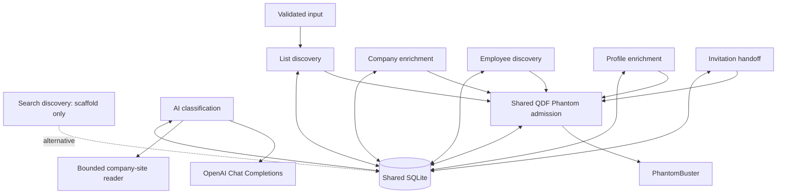
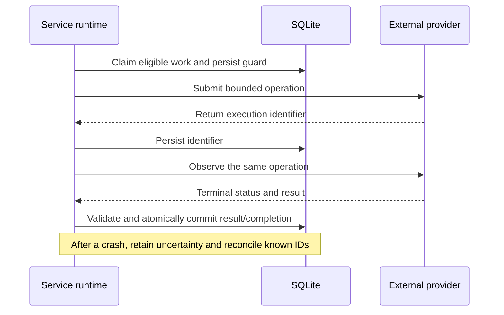
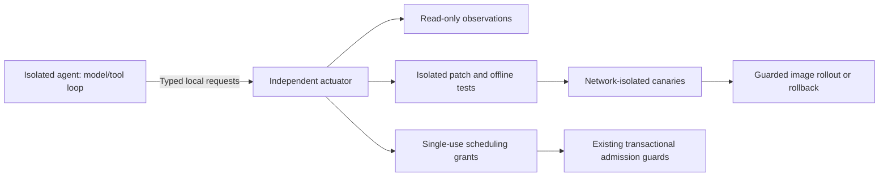

# Prospect Orchestrator — Architecture

> Documentation updated on **15 November 2026** from the supplied public-export documents. Deployment and application-test results below are dated **14 November 2026** or explicitly labelled earlier; no new EC2 inspection, application test run, or provider request occurred during this documentation update.

## System shape

Prospect Orchestrator is a single-host application with **seven business containers**, **one separate operations-agent container**, and an **independent host actuator**. Six business containers have implemented adapters; Search Export remains a scaffold. The business containers share one relational SQLite database; operational journals are separate. Services coordinate through committed database state; there is no central workflow service, message broker or direct downstream-service invocation.

Each implemented service runs one asynchronous execution owner. The common runtime polls for eligible work, while synchronous database operations run in worker threads. Network operations have separate timeouts and do not hold database writer locks.

Arrows to the database represent eligibility checks, work ownership and committed results. They do not imply that every service can dispatch work concurrently without limits.

## Components and responsibilities

| Component | Responsibility | Implementation boundary |
| --- | --- | --- |
| List discovery | Validate a selected list, admit companies and retain continuation state | Implemented adapter |
| Search discovery | Alternative discovery entry point | Service scaffold; business adapter absent |
| Company enrichment | Attach provider-attributed company facts | Implemented adapter |
| Employee discovery | Associate candidate people with selected companies | Implemented adapter; discovery does not establish qualification |
| Profile enrichment | Store reusable person-level evidence with source references | Implemented adapter |
| Classifier | Research bounded company-site evidence and validate a structured decision | Implemented adapter |
| Invitation handoff | Select eligible decisions, enforce policy and preserve contact suppression | Implemented adapter; acknowledgment is not delivery proof |
| Shared runtime | Intake, polling, claims, execution bounds, failure handling and status | Reused across service packages |
| Shared storage | Schema, identity resolution, transactions, guards, references and backup primitive | SQLite-backed package |
| Shared Phantom admission | Non-overlap, reviewed launch budgets, fair tickets, cooldowns and account pause | Deterministic SQLite primitives; no central business dispatcher |
| Autonomous operations agent | Model/tool incident loop, scheduling proposals and technical repair workflow | Separate isolated container; live inference disabled |
| Independent actuator | Observation, typed actions, source/test/canary gates and image rollback | Root-owned authority outside the editable checkout; no general shell tool |

## Data flow and ownership

The dependency order is list discovery, company enrichment, employee discovery, profile enrichment, classification and invitation handoff. Each stage consumes eligible committed evidence and records its own result. A service's failure does not replace another service's source facts.

Companies and people have stable identities. Separate association records represent a person connected to a target company. This avoids treating a selected target company as proof of the person's current employer. Alias handling permits corroborated profile identifiers to resolve to the same person.

Work records include the owning service, input fingerprint, source references, local lifecycle state and external execution identifier. Result-reference tables permit reuse across inputs and related associations without copying whole upstream datasets. Changed material evidence or classification policy can require a new decision while retaining earlier history.

## Persistence and concurrency

SQLite uses WAL journaling, foreign keys, STRICT tables, uniqueness checks and bounded lock waits. Transactional claims acquire a writer reservation, verify eligibility and persist ownership before external I/O. Result insertion and local completion are committed together.

Short transactions make a shared database practical at the intended scale. The tradeoff is a single writer and shared schema: independent service packages do not imply independent databases, horizontal scaling or distributed fault isolation. Multiple hosts sharing a live SQLite file are not established by this design.

## Operational journals, grants, and authority

| State or authority | Owner and boundary |
| --- | --- |
| Business SQLite database | Business services own entities, work/results, provider guards, invitation protection, and transactional scheduling admission. |
| Agent operational SQLite journal | The isolated agent owns incident progress and durable ownership/receipt evidence across restarts; it is separate from the business database. |
| Actuator operational SQLite journal | The independent host authority retains action/inference receipts, fencing, maintenance budgets, and repair evidence in its own state. Agent proposals are not self-authorizing. |

The agent runs non-root without network access or a Docker socket and submits typed requests over authenticated local transport. The separately installed root-owned actuator performs permitted observations and actions, applies independent policy, and retains substantial host authority. Its installation and policy are outside the editable application checkout; it exposes no general shell tool to the agent.

Scheduling proposals use **single-use grants**. Existing transactional admission still checks dependencies, reviewed launch allowances, quotas, spacing, cooldowns, and unresolved external operations. A grant cannot clear an uncertainty guard or supply missing operator authorization. Shared admission covers QDF-controlled Phantom launch paths; external dashboard schedules and other tools remain outside that authority.

Live operations-model inference remains disabled in the exported deployment. Implemented reasoning, repair promotion, canary, and rollback paths were verified with mocks and disposable state. Automatic source promotion covers only four reviewed failure/recovery functions; wider changes require review.

## External operations and recovery

There is an unavoidable uncertainty window if a provider accepts a request but its identifier is lost. The application retains a guard instead of claiming exactly-once execution or assuming that a timeout means nothing happened. Local work can be failed while the external operation still requires reconciliation.

## Decisions and tradeoffs

- **Database polling instead of a broker:** reduces infrastructure and keeps dependencies transactional, at the cost of polling latency and database contention.
- **Shared packages instead of duplicated service logic:** gives consistent recovery and input validation, but increases the importance of cross-service regression checks.
- **Conservative scalar provider inputs:** avoids guessing unsupported batch serialization, at the cost of additional launches. Provider batch caps are separate from workflow capacity.
- **Failure state separate from uncertainty guards:** makes failures visible without making dangerous retries eligible. Some unresolved work intentionally remains blocked.
- **Reference-aware retention:** removes eligible operational detail while retaining evidence needed downstream and permanent contact protection. Recovery must preserve those references.
- **Explicit coordination boundary:** all QDF-controlled Phantom launches share durable admission. External dashboard schedules, manual launches and other tools remain outside its control. The Classifier retains independent execution.

No queue cluster, Kubernetes deployment, vector database or model-training subsystem is needed to explain the implemented architecture. No high-availability or measured production-scale claim is made.

See [engineering](ENGINEERING.md) for implementation mechanisms and [evidence](EVIDENCE.md) for verification boundaries.

The operations authority complements the shared business workflow; it does not replace transactional admission or provider uncertainty protection. Broader source edits may be staged for review, while automatic promotion remains restricted to the reviewed technical surface and independent checks.

